# MAIN GAMEPLAY:

-   The rope system is a bit over the place right now; I want to tie it in with combat and with puzzles:
    -   Clove hitch: combat: Binds 1 enemy at a time permanently | puzzles: the same it does currently.
    -   Bruges whipping knot: combat: Deals ranged damage | puzzles: the same it does currently.
    -   Bowline rescue knot: combat: ensnares enemies in an AOE temporarily | puzzles: the same it does currently.
-   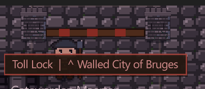
-   The gate looks very bad, also don’t put a text box, just always make someone stop you based on where you are in the story, take inspiration from how Pokémon(especially older games like emerald) stops you from going somewhere
-   I know the character grows taller, but still the scale of things throughout the game is completely of, in the first chapter port of bruges the houses are way bigger (Around 5 times the character) but then in bruges itself they are way smaller, also the gates are completely the wrong scale, also this make the cathedral look smaller than the uncle’s house.
-   Also related to this most buildings and some props seem to have a lower resolution than the rest of the game  
    Gate:  
    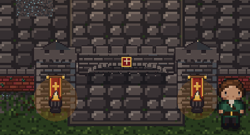

Uncles house:  
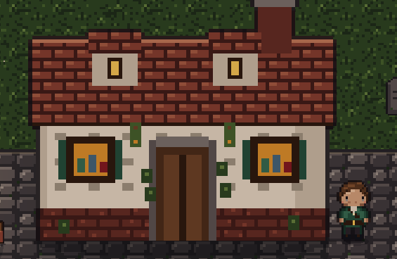  
Bruges house:  
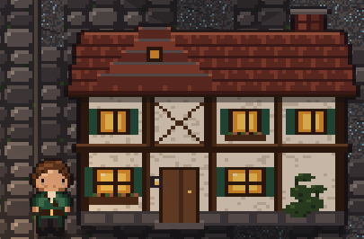

-   When I enter dialogue, I want the player to face who he’s talking, and I want the game to zoom in on the conversation.
-   Whenever you get a NEW item, I want it to show up like it does in Zelda OOT with a prompt to press \[I\] to see it in the inventory
-   NPC’s only have collision in bruges and sanctuary right now, make it everywhere.
-   Stylize all arrows like these for example OR rather replace them with actual stylized wayboards:
    -   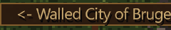
    -   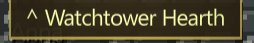

# Title screen

## Visual:

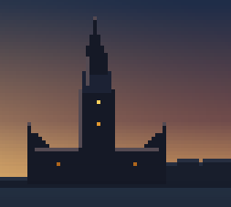

Part of spire is not symmetrical with that grey line

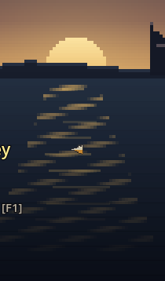

The sun isn’t lined up with its reflection

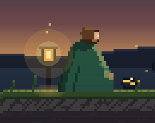

It doesn’t look like a cloak, it looks like bad art of a fat guy

## UI:

Add mouse control so you can click instead of just using the keyboard

# CH1

## Visual:

-   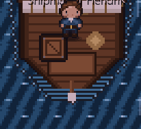
-   The boat travels to fast and even when standing still has bow waves
-   All npc’s are not animated
-   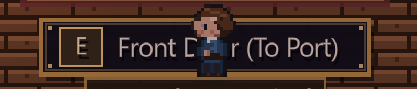
-   It shouldn’t show the (to port) popup
-   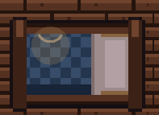
-   The interaction indicator is wrongly placed
-   When the sister is kidnapped, it should fade completely to black and you can only hear some sounds, also in the house make separate rooms for the uncle, the boy and the sister
-   When the abduction cutscene starts Anna shouldn’t disappear and the grunts must come from their actual location they were just at. Also, we don’t know Anna’s name at this point so just show something else on her dialogue

# CH2

# CH3:

## Visual:

-   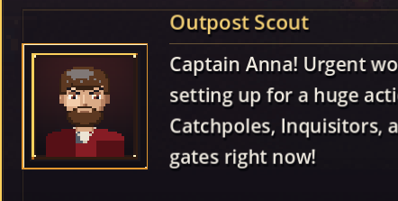  
    The outpost scout is green in game but the portrait is red
-   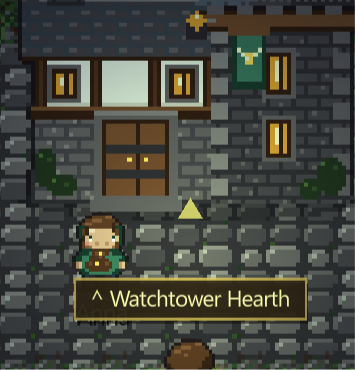  
    remove Anna and her dialogue from outside here

# CH4

## 4.1b:

-   Add more ridge searchers and make them search a bigger area also add more props and trees to hide behind

## 4.2:

-   Make the dropped ambush note just “Dropped note” also make the item look like an actual note and when you read it make it text on actual paper instead of just a dialogue box